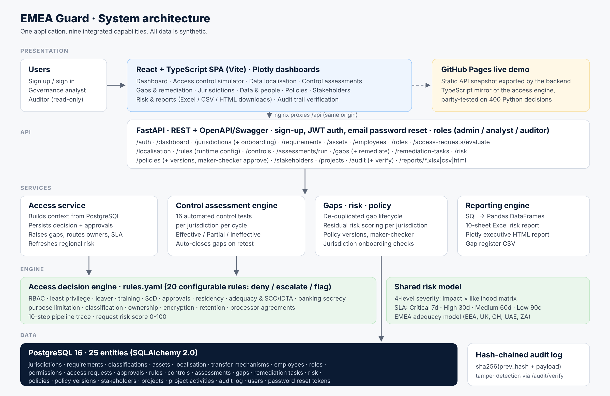

# EMEA Guard

**Enterprise Data Governance & Regulatory Control Management Platform**

[](https://github.com/Anush2712/emea-guard/actions/workflows/ci.yml)
[](https://anush2712.github.io/emea-guard/)

**Live site:** https://anush2712.github.io/emea-guard/ (create an account to sign in)

EMEA Guard simulates the internal platform a multinational bank's EMEA Data Governance team would use to manage, monitor and protect data across ten jurisdictions. It brings together jurisdiction requirements, RBAC and access validation, data localisation, automated control testing, compliance gaps, remediation, risk reporting, policy lifecycle, stakeholder ownership and a tamper-evident audit trail in **one application with one data model**.

> **All data is synthetic.** Regulatory content is a simplified model built for demonstration. It is not legal advice, not any institution's data and not a statement of anyone's compliance position.



**Python · FastAPI · SQLAlchemy · PostgreSQL · Pandas · Plotly · React · TypeScript · Docker · Pytest · GitHub Actions · JWT · Swagger**

---

## What it does, end to end

The headline scenario: **an employee in Germany requests access to customer data held in Ireland.** One API call (`POST /api/access-requests/evaluate`) runs the whole pipeline:

| # | Step | Where it happens |
|---|------|------------------|
| 1 | Identify the employee's jurisdiction | `services/access_service.build_context` |
| 2 | Identify the data's location and classification (unclassified data is treated as Restricted) | `engine/access.effective_classification` |
| 3 | Resolve applicable requirements: global (BCBS 239), EU (GDPR, DORA) and national, filtered by classification | `services/lookups.applicable_requirements` |
| 4 | Validate RBAC: role permission must cover domain × classification × access type | rule `ACC-001` |
| 5 | Check approvals exist and are fresh: line manager, data owner, DPO | rules `APR-001..004` |
| 6 | Evaluate all 20 configurable governance rules (deny / escalate / flag) | `engine/access.evaluate` + `engine/rules.yaml` |
| 7 | If a detective control fails, create a de-duplicated compliance gap | `services/gaps.raise_gap` |
| 8 | Route it to the accountable stakeholder (jurisdiction DPO, data owner, IAM, CISO…) | `services/lookups.owner_for` |
| 9 | Set a remediation deadline from the severity SLA and open a remediation task | `engine/severity.REMEDIATION_SLA_DAYS` |
| 10 | Write a hash-chained audit entry and recalculate regional risk | `services/audit`, `services/risk` |

Every decision stores its full trace (each step and each rule's result and message), so any decision can be explained after the fact.

## Platform scale (verified by tests)

| Metric | Value | Asserted in |
|---|---|---|
| EMEA jurisdictions | **10** (IE, GB, DE, FR, NL, LU, CH, PL, AE, ZA) | `test_platform_hits_target_metrics` |
| Regulatory requirements | **71** (2 global, 18 EU-wide, 51 national) | same |
| Registered data assets | **120**, stored in **223** monitored locations | same |
| Simulated employees | **240**, across **13** RBAC roles | same |
| Access requests | **330** evaluated by the engine + **60** legacy entitlements | `GET /api/metrics` |
| Governance validation rules | **20** (configurable at runtime) | `test_rule_set_size` |
| Automated control tests | **16** controls → **604** control assessments over 4 cycles | `test_platform_hits_target_metrics` |
| Database entities | **25** (+2 association tables) | same |
| Risk severity levels | **4** (Critical / High / Medium / Low) | `test_rating_scale_has_four_levels` |

The seed is deterministic: SQLite and PostgreSQL produce identical results.

## The nine capabilities

| Capability | What is implemented |
|---|---|
| **Governance dashboard** | Residual risk per jurisdiction, quarterly trend, open gaps by severity, access decisions, control results, priority gaps, live activity feed |
| **Jurisdiction management** | 10 jurisdictions with regulator, DPA, residency regime, banking secrecy, inherent risk; 71 mapped requirements; **onboarding workflow** with readiness checks (requirements, DPO, regulators) gating activation |
| **Access control** | RBAC (role × domain × max classification × access types), least privilege, leaver detection, training currency, segregation of duties, change tickets, approval workflow, interactive request simulator with full decision trace |
| **Data localisation** | Primary/replica/backup/DR location register, residency enforcement, EMEA adequacy model, transfer mechanisms (EU SCCs, UK IDTA, Swiss SCCs, intra-group agreements) with validity dates and transfer impact assessments |
| **Control assessments** | 16 automated tests (ownership, classification, encryption, retention, residency, transfer validity, training, leaver access, privileged review, recertification, dormant access, processor agreements, DPIA, RoPA, CID secrecy, policy review) run per jurisdiction; Effective / Partially Effective / Ineffective against configurable thresholds |
| **Policy management** | 12 policies, standards and procedures with version history, regulatory mapping, review cycles and a **maker-checker** approval (authors cannot approve their own change) |
| **Risk reporting** | Residual risk model, driver decomposition, history, **downloadable** 10-sheet Excel report, Plotly executive HTML report and CSV gap register (SQL → Pandas) |
| **Stakeholder management** | DPOs and stewards per jurisdiction, data owners per domain, control owners; live workload (open gaps, overdue, tasks, assets owned) |
| **Project & remediation tracking** | Gap lifecycle (Open → In Remediation → Resolved / Risk Accepted), remediation tasks with owners and deadlines, auto-closure when a control passes on retest, governance projects with milestones |

## How the control engine thinks

**Rules** (`backend/app/engine/rules.yaml`) have a severity, an effect and a flag for whether failure raises a gap:

- `deny` → request is **DENIED** (e.g. RBAC, residency, banking secrecy, expired SCC)
- `escalate` → **PENDING_APPROVAL** until approvals exist (e.g. data owner approval for Confidential data)
- `flag` → **APPROVED_WITH_FINDINGS**; access proceeds but the weakness is recorded (e.g. asset has no owner)

A key design point: **a preventive denial is the control working, not a gap.** Gaps are raised only when a failure reveals a broken control: a leaver could still raise requests, an asset has no owner, a transfer mechanism has expired. Admins can disable a rule, change its severity or its parameters through `PATCH /api/rules/{code}`; the change applies to the next request and is audited.

**Severity** uses a 4 × 4 impact × likelihood matrix (impact from data classification or control criticality, likelihood from rule severity or exception rate). Score 12–16 Critical, 8–11 High, 4–7 Medium, 1–3 Low. SLAs: Critical 7 days, High 30, Medium 60, Low 90.

**Residual risk** per jurisdiction:

```
residual = inherent multiplier × ( 0.45 × (100 − weighted control effectiveness)
                                 + 0.30 × open-gap pressure (severity-weighted)
                                 + 0.15 × overdue remediation % 
                                 + 0.10 × access denial rate % )        capped at 100
```

**History is generated, not hand-written.** The seed replays 2026 chronologically: 330 requests flow through the access engine as they "arrive", control cycles run at each quarter end, owners remediate a share of open gaps between cycles (the corrective action is actually applied to the data), and risk is recalculated after each cycle. Time-based tests (training expiry, mechanism expiry, dormancy) open new gaps as the year progresses. Legacy entitlements migrated from a "pre-platform" IAM system give the detective controls findings the preventive engine never saw.

**Audit trail** entries store `sha256(prev_hash + canonical payload)`. `GET /api/audit/verify` re-hashes the chain; the test suite edits a historical row and proves the break is detected.

## Run it

### Full stack with Docker (PostgreSQL + FastAPI + React)

```bash
git clone https://github.com/Anush2712/emea-guard.git
cd emea-guard
docker compose up --build
```

- App: http://localhost:8080
- API docs (Swagger): http://localhost:8080/docs
- The database seeds itself on first start (about 3 seconds).

Open the app and choose **Create an account**. The first account on a fresh database becomes the **admin**; later sign-ups join as **analyst**, and the admin can change anyone's role on the Account page.

| Role | Can |
|---|---|
| admin | everything, including users, rule configuration, policy approval, jurisdiction onboarding |
| analyst | submit access requests, run control tests, manage gaps and tasks, draft policies |
| auditor | read-only, verify the audit chain, download reports |

### Local development

```bash
# backend (needs PostgreSQL, or set EMEA_GUARD_DATABASE_URL=sqlite:///./emea.db)
cd backend
pip install -r requirements-dev.txt
uvicorn app.main:app --reload --no-proxy-headers  # http://localhost:8000/docs
pytest -q                                # 49 tests

# frontend
cd frontend
npm install
npm run dev                              # http://localhost:5173 (proxies /api to :8000)
```

### Deploy the API to Render (free tier)

`render.yaml` is a Render Blueprint (PostgreSQL + the API container). In Render: **New → Blueprint → select this repo**.

## The live demo (GitHub Pages)

GitHub Pages only serves static files, so the Pages build works like this:

1. CI seeds a fresh database and calls every read endpoint through the real FastAPI app (`python -m app.scripts.export_demo`), writing a JSON snapshot plus the generated Excel/HTML/CSV reports.
2. The React app is built in demo mode and reads that snapshot.
3. Access requests in the demo are evaluated by `frontend/src/demo/engine.ts`, a TypeScript mirror of the Python engine. **CI fails if the mirror disagrees with the Python engine** on any of 400 exported decisions (decision, risk score, failed rules and applicable rules: `frontend/src/demo/parity.test.ts`).

Other write actions in the demo (gap updates, policy drafts, rule toggles) apply to the browser tab only. Run Docker for the full persistent stack.

## Testing and CI

- **49 backend tests:** account security (hashing, case-insensitive uniqueness, password change revoking sessions, atomic single-use reset links, identical forgot-password responses, no reset links in non-development logs, spoofed-header rate limiting, admin guard), pure engine unit tests (every rule family, severity matrix, adequacy model), API and workflow tests (auth and roles, the DE → IE scenario end to end, gap routing and deadlines, runtime rule reconfiguration, control cycle → remediation → retest → auto-close, audit tamper detection, report downloads, maker-checker, onboarding).
- The suite runs on **SQLite and on PostgreSQL 16** in CI.
- **Engine parity test** between Python and TypeScript.
- **Docker smoke test**: CI builds the compose stack, waits for health checks and calls the API through nginx.
- Linting with Ruff; strict TypeScript.

## Repository layout

```
backend/
  app/
    engine/        pure decision logic: access.py, rules.yaml, severity.py, transfers.py
    services/      access_service, assessments (control tests), gaps, risk, reporting, audit, lookups
    routers/       core (auth, dashboard, jurisdictions), governance, reports
    seed/          reference.py (jurisdictions, requirements, controls, policies), generate.py (2026 replay)
    scripts/       export_demo.py (static snapshot + parity fixtures)
    models.py      25 SQLAlchemy entities
  tests/
frontend/
  src/pages/       11 screens + sign-in, sign-up, password reset and account
  src/demo/        static demo adapter + TypeScript engine mirror + parity test
docs/              architecture diagram, control engine and regulatory model notes, demo walkthrough
```

## Further reading

- [docs/CONTROL_ENGINE.md](docs/CONTROL_ENGINE.md): every rule, control test and scoring formula
- [docs/REGULATORY_MODEL.md](docs/REGULATORY_MODEL.md): jurisdictions, requirements and simplifying assumptions
- [docs/DEMO_WALKTHROUGH.md](docs/DEMO_WALKTHROUGH.md): a 5-minute guided tour
- Demo video: [docs/media/emea-guard-demo.mp4](docs/media/emea-guard-demo.mp4)

## Limitations and next steps

- Regulatory content is simplified and synthetic; adequacy, residency and secrecy rules are modelled, not legally verified.
<!-- coderabbit-ai-generated:v1 -->

<!-- coderabbit-ai-generated-section:v1:d328e327924a1a2bf43e13d7047e944c4e8f0c0312995bd38d76b47b9bdc1b9f -->

- Schema is created with `create_all`; a production version would use Alembic migrations. Existing databases from before account registration lack required user columns. For a disposable Compose demo, back up anything you need, then run `docker compose down -v` (deletes all project volume data) and `docker compose up --build` to recreate and reseed. For SQLite, stop the API and start it with a new database file. Register the first admin again. Environments that must retain data need a migration before upgrading.

<!-- /coderabbit-ai-generated:v1 -->
- Authentication is local JWT; an enterprise deployment would federate with the bank's IdP (SAML/OIDC) and derive roles from groups.
- Control tests load each cycle's population into memory, which is fine at this scale; at bank scale they would be pushed down into SQL.

---

## Accounts and security

<!-- coderabbit-ai-generated:v1 -->

<!-- coderabbit-ai-generated-section:v1:3856d1108102518a30e29f397ff1b70d0b5123427599c5fa38a3cabeaefb3840 -->

- **Sign-up** with a username you choose, an email and a password (at least 10 characters, at most 72 UTF-8 bytes, with a letter and a number, not containing the username). Usernames are unique case-insensitively in the database itself (a lower-cased key column with a unique index), and emails are stored normalised. Sign-up returns a conflict for a taken username or email. Sign-ups are serialised (process lock plus a PostgreSQL advisory lock), so two simultaneous first sign-ups can't both become admin.

<!-- /coderabbit-ai-generated:v1 -->
- **Passwords are never stored**, only bcrypt hashes. Sign in with your username or your email.
- **Change password** from the Account page (current password required). Changing or resetting a password, or disabling an account, bumps a token version, so every other signed-in session is signed out.
- **Forgot password** sends a single-use link that expires in 30 minutes. Only the token's SHA-256 hash is stored, a new request invalidates older links, and using a link is an atomic conditional update, so two concurrent uses can't both succeed. A weak new password doesn't burn the link. The API response is identical for registered and unregistered emails, and the lookup runs after the response is sent, so timing doesn't reveal accounts either. **The link only ever travels by email**: never in an API response, and never written to logs outside an explicit development environment.
- **Email delivery** via the Resend HTTPS API (`EMEA_GUARD_RESEND_API_KEY`) or any SMTP relay (`EMEA_GUARD_SMTP_*`). The API logs an error at startup if neither is configured outside development.
- **Rate limiting** on sign-in, sign-up, forgot and reset uses the connection peer unless that peer matches `EMEA_GUARD_TRUSTED_PROXY_NETWORKS` (a JSON list of CIDRs) and `EMEA_GUARD_TRUSTED_PROXY_HOPS` is positive. Compose trusts only nginx, which overwrites the forwarded address. Deployments without verified ingress settings, including Render by default, can share a bucket among clients behind the same proxy. When starting Uvicorn yourself, pass `--no-proxy-headers` so the application can check the original connection peer.
- **Admin user management** (roles, disabling accounts) with a last-active-admin guard that row-locks the admin rows before counting. Every account event goes to the hash-chained audit trail.

### Connecting the live site to a real database

GitHub Pages can only host static files. Until an API is connected, the live site runs on the bundled snapshot and keeps accounts **in your browser** (PBKDF2-hashed), and password reset by email is unavailable. To switch it to PostgreSQL-backed accounts with email resets:

1. Deploy the API with the Render Blueprint (`render.yaml`) and set `EMEA_GUARD_RESEND_API_KEY` and `EMEA_GUARD_SMTP_FROM` in Render. Render's free tier blocks outbound SMTP, which is why the Blueprint uses Resend's HTTPS API.
2. In GitHub: **Settings → Secrets and variables → Actions → Variables → New variable** named `EMEA_GUARD_API_URL` with the API URL (for example `https://emea-guard-api.onrender.com`).
3. Re-run the *Deploy live demo* workflow. The site now signs up, signs in and resets passwords against the API.

---

Built by [Anush Choudhary](https://anush2712.github.io/anush-website/) as a portfolio project. Synthetic data only.
